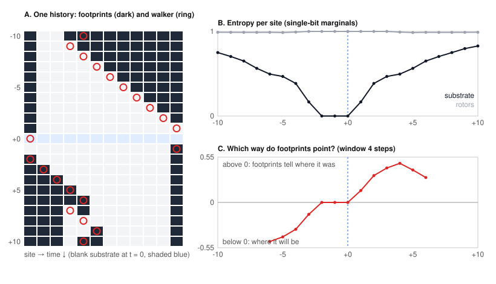

# Where does the direction of records come from?

*Coordinator draft, 17 November 2026. Finite reversible bit models, checked by exact enumeration in [check_records.py](check_records.py) (Results 1–4) and [trail_records.py](trail_records.py) (Results 5–7). Not independently reviewed. No priority claim: the observations are elementary. The literature check is in "Literature position" below. Most results are known in substance.*

## The question

The [arrow audit](../ontology-reconstruction/coordinator/roadmap-audit-2026-10-31/ARROW_DISPOSITION.md) and the massive-field notes show that fixing is mirror-symmetric under a time-reversing isometry. Even so, a photograph of yesterday's rain is a trace, and a perfect forecast of tomorrow's rain is not. Take a reversible gate that flips a memory bit when a signal is 1. If the bit starts blank, its final value gives the signal. If the bit ends blank, its initial value gives the signal equally well. This lane asks what has to be added to the reversible law to make the first case a record and the second not:

- a low-entropy boundary;
- the location of correlations;
- counterfactual robustness;
- an independent causal direction.

The four results below are about these toy models only. They bound what a general account can say. They are not a general theorem.

## Models

A gadget has an event bit `S`, a device bit `D`, a coupling switch `K` and a scrambler `E`. Step 1 is the Toffoli gate `D ← D ⊕ (S∧K)`. Step 2 is `S ← S ⊕ E`, which makes the event transient: when `E` is uniform, `S` at time 2 carries no information about the event. Both gates are involutions, so the dynamics are reversible and fine-grained Shannon entropy is conserved. An ensemble is a uniform distribution over a listed set of microstates. Parts 2 and 4 use a reduced gadget `(S, D)` with the single step `D ← D ⊕ S`.

## Result 1. A global entropy profile does not say where the records are

Take two gadgets under the same dynamics.

- **Ensemble A.** Gadget 1 is blank and coupled (`D=0, K=1`). Gadget 2 is pre-correlated and uncoupled (`D′=S′, K′=0`).
- **Ensemble B** swaps these two preparations.

The two ensembles have identical values at t = 0, 1, 2 for:
- joint entropy, which is constant at 4 bits;
- the sum of single-bit marginal entropies (5, 6, 6);
- a coarse-grained Gibbs entropy over total Hamming weight.

The swap carries any coarse-graining that treats the two gadgets alike to the same profile. In both ensembles, device `D` at time 2 matches the event `S` at time 0 in every member, with mutual information 1 bit, while `S` itself has lost the information. Flip `S` at time 0, holding every other initial bit fixed: in A, `D` follows every time, and in B it never does. A's device holds a robust trace of the transient event. B's device holds an accidental match that would fail if the event had differed. A global entropy profile, however it is coarse-grained, does not locate the trace.

The Hamming-weight entropy is not monotone in this model. The claim is only that the two profiles are equal.

## Result 2. Counting microstates does not decide which way records point

Take n = 4 reduced gadgets and two initial cells of the same size, 2⁴ microstates each:

| Initial cell | Marginal entropy t0 → t1 | I(device after; event) | I(device before; event) |
|---|---|---|---|
| blank, `D=0` | 4 → 8 | 1.00 | 0.00 |
| pre-correlated, `D=S` | 8 → 4 | 0.00 | 1.00 |

Any entropy that counts microstates gives the two cells the same value. Only the blank cell produces past-directed records. The pre-correlated cell gives future-directed "pre-records", and its device ends blank. What separates the two is where the low entropy resides. In the blank cell, the low entropy sits in the device marginals and there is no correlation between device and event. In the pre-correlated cell, the same deficit sits in a correlation. A low-entropy boundary explains past-directed records only when its entropy measure is low because the parts are individually definite and uncorrelated. This makes precise the gap between being globally unusual and being locally prepared blank. In the table, the marginal-sum entropy increases exactly in the direction the records point.

## Result 3. Counterfactual robustness is symmetric until you say what is held fixed

Take one gadget and two ensembles:
- blank at t = 0, giving a forward record;
- blank at t = 2, its time reverse, giving a pre-record.

| Ensemble | Hold t=0 fixed, flip the event: late device depends / stays in cell | Hold t=2 fixed, flip the event: early device depends / stays in cell |
|---|---|---|
| blank at t=0 | 1.00 / 1.00 | 1.00 / 0.00 |
| blank at t=2 | 1.00 / 0.00 | 1.00 / 1.00 |

Counterfactual dependence holds in both directions in both ensembles, because the gate is a bijection. So "would the device still work had the signal differed?" picks out nothing until you specify the intervention. The two cases separate on one point: whether the intervention keeps the world inside the ensemble's boundary cell. With the blank-past ensemble, an intervention that holds the past fixed respects the blank boundary. One that holds the future fixed backtracks into a non-blank past. Robustness here means dependence under interventions that preserve the boundary condition. The time-reversed ensemble, held at its own boundary, certifies its pre-records by exactly the same criterion.

## Result 4. In the toy, conditioning on a low-weight cell makes records typical toward that cell

Take n = 5 reduced gadgets with the uniform measure on microstates whose total Hamming weight is at most k at one time. The table gives per-gadget mutual information, averaged over gadgets:

| k | Cell at t=0: I(D_t1;S), I(D_t0;S) | Cell at t=1: I(D_t1;S), I(D_t0;S) |
|---|---|---|
| 2 | 0.236, 0.007 | 0.007, 0.236 |
| 4 | 0.082, 0.005 | 0.005, 0.082 |
| 6 | 0.008, 0.001 | 0.001, 0.008 |

Records point toward the conditioned time, with an exact mirror. The effect vanishes at k = 0, where the event is fixed too, and when the cell is the whole space. A low-weight cell works because it is low in marginal entropy, as in Result 2. It also lowers the entropy of the event, so the informative regime is intermediate. In this toy the thermodynamic account passes its fair test: under the conditioned uniform measure, past-directed records are typical rather than exceptional. That holds only because the weight macrostate makes device blankness typical. A cell of the same size defined by `D=S` would reverse the verdict.

## A walker that leaves footprints: Results 5–7

*Added the same day. The model is in [trail_records.py](trail_records.py), checked by exact enumeration.*

Gadgets 1–4 are static. This model adds motion, unpredictability and a picture. A walker moves on a ring of 12 sites. Each site has two bits that couple to the walker in exactly the same way: each toggles when the walker arrives.

- **Rotors** steer the walker. On arrival the walker reverses direction if the rotor is set, and then the rotor toggles.
- The **substrate** takes footprints. It toggles when the walker arrives.

Every substep is invertible. The ensemble is uniform over 4,096 microstates. At t = 0 the walker is at site 0 heading right, the substrate is blank, and the rotors are uniform. The ensemble is evolved both forward and backward. For each site, "footprints point to the past" is measured as I(substrate bit at t; parity of walker arrivals at that site during (t−4, t]). "Point to the future" uses (t, t+4].

**Result 5: a Janus point.** In panel B, substrate entropy rises in both directions away from t = 0. In panel C, footprints carry information about where the walker was for t > 0 and about where it will be for t < 0. The values mirror exactly: 0.167, 0.385, 0.468, 0.496 at t = +1…+4 against the same values at t = −1…−4. Panel A shows one history. Read downward, the trail grows after t = 0. Before t = 0, the walker erases a pre-existing trail exactly as it reaches each site, which is what a record looks like when it is read in the anti-record direction. An observer at either t = −5 or t = +5 finds that their footprints point toward t = 0. Each of them calls that direction "the past".

**Result 6: identical coupling, no record.** The rotors toggle on every visit, just as the substrate does, but they start uniform. At t = 6 they carry 0.017 bits per site about past visits, against 0.325 for the substrate. This is Result 1 in dynamic form. The coupling is shared; what differs is the preparation. Locally prepared blankness is what makes the difference.

**Result 7: present-only conditioning makes the footprints untrustworthy.** Condition only on what an observer sees at T = 6: the walker's position and the substrate pattern. The direction and the rotors are uniform, and nothing is imposed at t = 0.

- For the most common observation, a short back-and-forth trail, 512 of 8,192 compatible microstates (1/16) evolve back to a blank substrate at t = 0.
- For the longest trail, `111110000001`, the count is 256 of 8,192 (1/32). Only 128 of those (1/64) come from the actual boundary cell.

In every other compatible microstate, the trail was already partly present before the walker passed. It is a fluctuation, not a trace of where the walker went. The footprints are reliable only because of the boundary condition imposed at t = 0. They are not reliable given the present observation together with a uniform measure. This is the toy form of the Boltzmann-brain worry, and of the reason the Past Hypothesis is posited as an extra assumption. The ratio falls as the trail grows here, but this run does not establish how it scales.

**A dropped attempt.** I first tried a generic scrambling circuit: 15 bits, random 3-bit involution layers, and a time-reversal-invariant step U = A·B. That gave no usable record signal. The entropy saturated within about two steps. Spurious single-bit correlations in the 576-state ensemble, about 0.08 bits, swamped any lagged-information asymmetry. Records need a dedicated recording structure, which a generic scrambler does not provide.

## Pushing further: Results 8–10

*Added the same day. Result 8 is a short proof. Results 9 and 10 are computed exactly in [push_records.py](push_records.py), which uses the same dynamics as the trail model written with bitmasks.*

**Result 8: the record ledger (elementary lemma).** Let a recorder R be updated by a permutation of its states chosen by an event E: R₁ = f_E(R₀), with each f_e a bijection. If R₀ is independent of E, then

  I(R₁; E) = H(R₁) − H(R₀).

*Proof.* H(R₁ | E) = H(f_E(R₀) | E) = H(R₀ | E) = H(R₀). The first equality holds because each f_e is a bijection. The second holds by independence. Subtract from H(R₁). ∎

Read the same dynamics backward and the mirror holds: if R₁ is independent of E, then I(R₀; E) = H(R₀) − H(R₁). So a recorder carries information about an event in the direction in which its own entropy rises from a state independent of that event, and by exactly that amount. The maximum is log|R| − H(R₀): blankness is the resource, measured in bits. Results 2 and 6 are instances. The blank substrate gains entropy and records. The uniform rotors cannot gain entropy and record nothing. The lemma assumes that R₀ does not influence E. The rotors violate this, because they steer the walker, so their 0.017 bits are not covered by it. This is presumably standard, and close to Landauer-style accounting. It is stated here because it turns "locally prepared blank bit" into a quantity.

**Result 9: how fast fake records outnumber real ones.** Condition only on the present observation (walker position and footprint pattern) at elapsed time T. The table gives the probability, averaged over observations drawn from the boundary ensemble, that the compatible microstate had a blank substrate at t = 0.

| T | Mean trail (sites) | P(blank at 0 \| observation) | P(exact boundary cell \| observation) | Straight trail of T sites: P(blank) |
|---|---|---|---|---|
| 2 | 2.0 | 0.500 | 0.125 | 2⁻¹ |
| 4 | 2.0 | 0.188 | 0.070 | 2⁻³ |
| 6 | 2.5 | 0.086 | 0.036 | 2⁻⁵ |
| 8 | 3.0 | 0.038 | 0.019 | 2⁻⁷ |

The values are identical for rings of 10, 12 and 14 sites; only sites within reach of the walker matter. A ring of 8 differs at T = 8 because the walker can wrap around. For a straight trail of k sites, the probability that it is a genuine trace is exactly 2^−(k−1): every rotor along the path has to happen to point the walker the right way. Given only the present, the trustworthiness of a footprint record falls exponentially with how much it records. This is the finite form of the Boltzmann-brain point. It makes clear that the Past Hypothesis has to supply far more than the present macrostate does.

**Result 10: two blank boundaries make records ambiguous.** Impose a blank substrate at both t = 0 and t = 8 (L = 12, which leaves 256 of 4,096 microstates). Then every site is visited an even number of times over (0, 8]. Each footprint equals both the parity of past visits since t = 0 and the parity of future visits until t = 8. With a 2-step window, past- and future-directed information are equal at every interior time: 0.333, 0.167, 0, 0.167, 0.333 for t = 2…6. The one-boundary ensemble gives 0.385 against 0.071 at t = 2. The asymmetry is gone, not reduced. With two low-entropy boundaries, the same local state is equally a trace and a forecast, and only a context-dependent reader could treat it as one rather than the other. This is the finite analogue of Schulman's two-time boundary conditions (a lead, not read).

## Where direction enters in these models

1. **The boundary cell.** One boundary is low in marginal entropy (Results 2 and 4). Which time carries the cell is an input. The dynamics are symmetric.
2. **The held-fixed set for counterfactuals.** Robustness is decided by which boundary an intervention must respect (Result 3). If the held-fixed set is identified with the conditioned low-entropy boundary, one assumption carries both. Then no independent causal direction is needed in these models. Without that identification, holding the past fixed is a separate stipulation. That stipulation is exactly where an independent causal direction would enter.
3. **Location, not quantity.** No global entropy number locates the traces (Result 1). The explanation needs the distribution of correlations over subsystems, which is more than an entropy profile. The ledger (Result 8) gives the right local quantity: the recorder's own entropy rise from an event-independent state.
4. **One boundary, not two.** A single low-entropy boundary gives records a direction. Two such boundaries remove it (Result 10). The present alone gives records that are exponentially unlikely to be genuine (Result 9).

For the project's question: if the identification in item 2 can be defended, the everyday sense that the past is settled by traces gets an explanation that is neutral between temporal ontologies. That explanation is a boundary condition plus a matching convention for counterfactuals. The models do not show that the identification is forced.

## Literature position (checked 17 November 2026)

Source records, with exact versions and read depths, are in [sources.jsonl](sources.jsonl). Three sources were read in full text through a fetch tool that summarizes, so their locators are not line-checked: Mlodinow–Brun 2014, Wolpert–Kipper 2024 and Rovelli 2022. Elga 2001 and Stradis 2024 were read at abstract depth. Schulman, Barbour–Koslowski–Mercati and Loewer 2007 are at discovery depth only. Albert's *Time and Chance* has not been checked.

| Result | Nearest prior work | Verdict |
|---|---|---|
| 1. Profile does not locate records | Wolpert–Kipper argue against Albert–Loewer that the entropy gradient of the objects we know about is not enough. Rovelli requires systems to be separated. | Known in substance. The equal-profile pair is only an illustration. |
| 2. Equal count, different residence | Wolpert–Kipper's Type-3 memory requires an initialized "ready" state with low *marginal* entropy. | Known. |
| 3. Robustness needs a held-fixed boundary | Mlodinow–Brun's "generality" condition varies the system's initial state while holding the memory's initial state fixed, and requires the reference time to be a thermodynamic initial condition. The literature on Lewis and Elga treats the counterfactual asymmetry. | Known in substance. Mlodinow–Brun build the choice into the definition. The toy shows that the choice alone breaks the symmetry. |
| 4. Typicality under a conditioned cell | The Albert–Loewer program. Stradis argues that its explanation of the record asymmetry is circular. | Known program. The toy succeeds only because its cell already makes the devices blank, which may bear on Stradis's worry. That has not been checked against his full text. |
| 5. Janus point | Barbour–Koslowski–Mercati's two-sided arrows. Carroll–Chen is a known lead, not looked up. | Known picture. The toy illustrates it. |
| 6. Same coupling, random preparation | Wolpert–Kipper's distinction between Type-3 and other memory types. | Illustration. |
| 7, 9. Present-only conditioning | The standard argument that records are unreliable without the Past Hypothesis, as in Albert and Loewer. Mlodinow–Brun's future read-outs are unstable states. | Known. The 2^−(k−1) figure is plain counting in this toy. |
| 8. Record ledger I = H(R₁) − H(R₀) | Rovelli states the heuristic bound I < ΔS/k from heat flow. Wolpert–Kipper give only a maximum value, min(ln\|M*\|, ln\|W\|). | No exact statement located in these three. It is an elementary information identity and is presumably known elsewhere, so no priority claim. |
| 10. Two boundaries cancel the direction | Wolpert–Kipper §6 condition on two times under the Past Hypothesis (a Brownian-bridge "turnover"). Schulman works with two-time boundary conditions. | Known in substance. The toy shows exact cancellation in one model. |

**A tension that turns out to be apparent.** Mlodinow–Brun say that initializing a reversible memory to 00…0 is "not necessary". Their rotor's reference position is arbitrary, but it is known, and their read-out subtracts it. In ledger terms, what matters is that H(R₀) is low and that R₀ is independent of the event, not that R₀ takes any particular value. "Blank" should therefore be read as "in a known state, uncorrelated with what it will record". Result 2's pre-correlated cell is known, but it fails the independence condition. Their view and Results 2, 6 and 8 agree on this reading.

**What survives as this lane's contribution.** There is no new physics and no priority claim. Three things remain:
- exact, runnable toy models that make the known positions concrete, including the figure;
- the exact ledger (Result 8) as the quantitative form of Wolpert–Kipper's ready-state requirement, so long as no prior statement turns up;
- the diagnosis that the counterfactual criterion and the boundary condition are two separate places where direction enters. Mlodinow–Brun build the first into their definition of a memory, and Albert–Loewer derive it from the second.

The remaining philosophical question is whether that derivation is circular. Stradis's paper is where to test it.

## Limits

- The models are finite, deterministic bit models with hand-chosen gates. There is no mixing, no macroscopic number of degrees of freedom, and no spacetime structure.
- "Entropy" here means Shannon entropy of explicit ensembles plus two named coarse-grainings. These are not Boltzmann entropies of a physical macrostate partition.
- The event is a single bit. Reliability is mutual information, with no noise model and no cost of operation.
- Result 4 uses one cell family, total Hamming weight. Its typicality verdict does not carry over to other measures.

## Next steps

1. **Read the literature.** *Partly done; see "Literature position". Still to do: Stradis 2024 in full text, Albert 2000 (the chapters on records and counterfactuals), Loewer 2007, Elga 2001 in full text (the fetched PDF was an image scan), and a search for a prior statement of the ledger.* The original list: None of these has been read for this lane, so read depth is discovery or none:
   - Mlodinow and Brun, [Phys. Rev. E 89, 052102](https://doi.org/10.1103/PhysRevE.89.052102), on robustness and fine-tuning.
   - Wolpert et al., [Memory Systems, the Epistemic Arrow of Time, and the Second Law](https://pmc.ncbi.nlm.nih.gov/articles/PMC10888154/), for its taxonomy of memory systems.
   - Albert's *Time and Chance* (2000), Elga (2001) on statistical mechanics and the asymmetry of counterfactual dependence, and Loewer on counterfactuals and the second law. These are leads from background knowledge. They are expected to state versions of item 2.

   Then position Results 1–4 against them, or retract them as known.
2. **Present-only conditioning.** Results 7 and 9 give finite versions, with exact 2^−(k−1) scaling for straight trails. Still open: a model in which the observer is itself a record-bearing subsystem rather than an external reader, and a check that a reader inside the model would draw the same inference.
3. **Connect to the noisy-threshold theorem.** Add a preparation stage with a dissipation cost to the [noisy-record model](../horizons/noisy-past-and-future-averages.md), whose error model is time-symmetric. Ask whether the D(T)/√T threshold acquires a direction.
4. **Connect to the steering note.** The no-bypass premise of the [steering note](../agentic-philosophy/when-does-a-decision-steer.md) plays the role here of "the coupling, not a pre-existing correlation, produced the match" (Result 1, ensemble B). Check whether its four-actuator identification analysis transfers to record identification.
